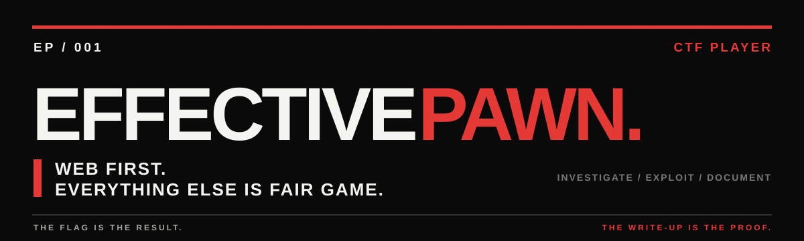

  

<strong>CTF PLAYER &nbsp; / &nbsp; WEB EXPLOITATION &nbsp; / &nbsp; GENERALIST</strong>

---

## 01 / ABOUT

Recently started competing in CTFs. Here for the problems, not the badges.

Web is my first stop. Not my only one.

PWN, reverse engineering, cryptography, forensics, OSINT, misc — the category matters less than the problem.

Recon. Wrong turns. Exploit chain. Root cause. That's the part worth documenting.

---

## 02 / COMPETITION EXPERIENCE

**SELECTED CTF COMPETITIONS**

- Google Cloud Security — Operation Cymbal: Coldroom 2026 CTF · **INDIVIDUAL**
- HITCON CTF 2026
- Seize Da Flaq (CTF7)
- SecLeaf CTF
- Securinets CTF
- Sea of Secrets
- Slay CTF

---

## 03 / AREAS OF OPERATION

| DOMAIN | FOCUS |
|:---|:---|
| **WEB** | Web exploitation |
| **PWN** | Binary exploitation |
| **RE** | Reverse engineering |
| **CRYPTO** | Cryptographic challenges |
| **FORENSICS** | Digital investigation |
| **OSINT** | Open-source intelligence |
| **MISC** | The unexpected |

---

## 04 / THE WORK

I document what I solve.

Not just the final payload. The evidence, hypotheses, dead ends, exploit path, and root cause.

**Featured writeup:** [Lester's Last Call — DTMF & Audio Forensics](./writeups/lesters-last-call/README.md)

---

## 05 / THE RECORD

CTF participation certificates and competition records.

*Certificate archive will be linked here.*

---

## 06 / CONTACT

| PLATFORM | HANDLE |
|:---|:---|
| DISCORD | `@effectivepwn` |
| CTFTIME | `effectivepawn` |
| INSTAGRAM | `@effectivepawn` |

---

  <strong>LESS TALK. BETTER EXPLOITS. STRONGER WRITEUPS.</strong>

